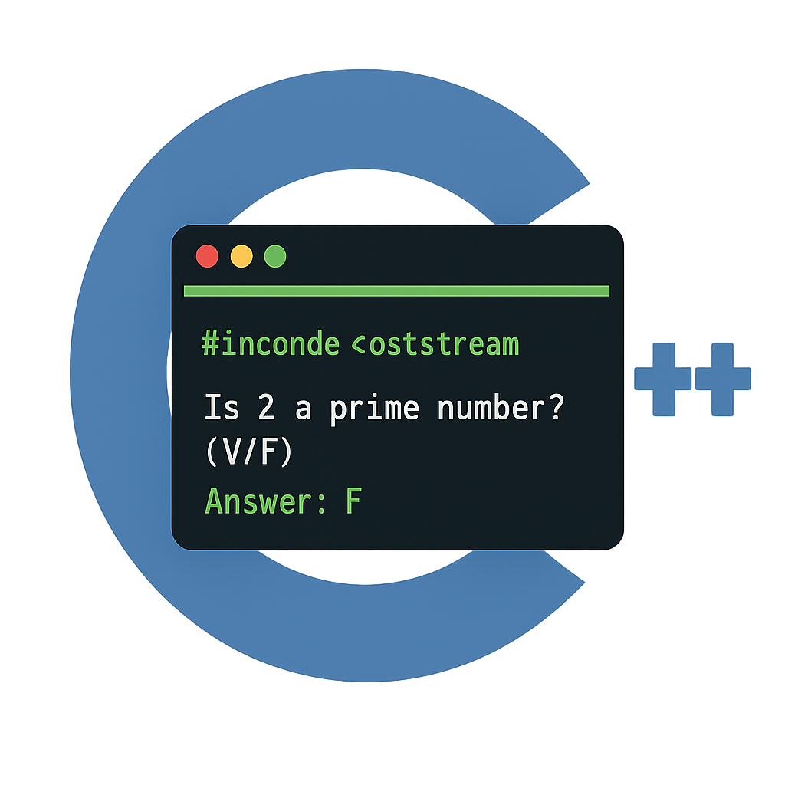

# Tester
El proyecto consta de dos partes:
<table align="center">
  <tr>
    <th><h2>Escriba.py</h2></th>
    <th><h2>Tester.exe/.sh</h2></th>
  </tr>
  <tr align="center">
    <td></td>
    <td></td>
  </tr>
  <tr align="center">
    <td>Es un programa en python que <strong>extrae las preguntas ya hechas de una imagen</strong> y las formatea para que el <em>tester</em> las entienda.</td>
    <td>Es un programa en C++ que toma como entrada un <strong>archivo con preguntas .txt</strong> (ya sea de opciones o V/F) y te evalua.</td>
  </tr>
</table>

> [!important]
> **PARA MUCHA MÁS INFORMACIÓN, ESQUEMAS Y AYUDAS VISITA** 👉 https://deepwiki.com/cmc00150/Tester/1-home

# ⬇️ Descarga
Puedes descargar ambos programas [aqui](https://github.com/cmc00150/Tester/releases/tag/v1.1.0-beta.1).

## 🏋️‍♂️ Preparación del Escriba
1. El escriba.whl se puede extraer en tu entorno global de python, pero para tenerlo más organizado lo suyo es que creemos uno solo para él. De forma que luego sea mas facil de desinstalar si asi se quiera.

   > 1. Creamos una carpeta donde vamos a tener el entorno de python: `mkdir carpeta_venv`.
   > 2. Nos metemos dentro de la carpeta para mayor comodidad: `cd carpeta_venv`.
   > 3. Creamos el entorno venv: `python3 -m venv nombre_del_entorno`.
   > 4. Dentro de la carpeta principal, se habrá creado otra con el nombre del venv. Para activarlo debemos llamar al **activate** dentro de esta: `nombre_del_entorno/Scritps/activate`.
2. Ahora para extraer el archivo wheel debemos poner: `pip install escriba-1.0.0-py3.whl`.
3. El ejecutable estará dentro de la carpeta:

     Windows : `nombre_del_entorno/Scritps`.
   
    Mac / Linux : `nombre_del_entorno/bin`.
7. Al pedirte una clave API, deberás cogerla del servicio de google: https://aistudio.google.com/prompts/new_chat. Donde pone `Get API key` (arriba a la derecha).
8. Pega la key, vuelve a iniciar el escriba y Voilà!!

> [!IMPORTANT] 
> Si lo instalas de forma global, al instalarse aparecerá: `WARNING: The script escriba.exe is installed in 'C:\Users\Asus\AppData\Local\Packages\PythonSoftwareFoundation.Python.3.13_qbz5n2kfra8p0\LocalCache\local-packages\Python313\Scripts' which is not on PATH`. A lo que se refiere es que el **escriba** se ha descargado en esa localizacion y no es está en el PATH, por lo que si quieres usarlo en otro lado tienes que usar esa ruta. El ejecutable estará en esa carpeta __Scripts__.

# ✅ Modo de uso
> [!IMPORTANT]
> Por como funciona linux, los archivos se descargaran sin permisos de ejecución. Por lo que para usarlos deberás darles permisos con `chmod u+x <nombre_programa>`. De esta forma solo tu tendrás permisos de ejecución.

> [!NOTE]
> En windows es lo mismo solo que le añade la extensión `.exe` a cada uno.
> ### Se recomienda el uso de _powershell_ en vez de cmd!!.
<h2></h2>

```
./escriba [-vf|-ab] [imagen1, imagen2, ...]
OPTIONS:
  -ab      Para que interprete la imgen como un archivo con preguntas de varias opciones.
  -vh      Para que interprete la imgen como un archivo con preguntas de verdadero o falso.
```

<h2></h2>

```
./tester [opciones] [flag](obligatorio) [directorio](obligatorio)
FLAGS:
  -vf             Para documentos de verdadero y falso.
  -ab             Para documentos de varias opciones.

OPCIONES:
  --random                Muestra las preguntas de forma aleatoria (default: forma ordenada).

  --time                  Establece un tiempo de delay entre pregunta y pregunta (default: 0), debe ser 0 o mayor que 0.

  --penalty               Establece cuantos fallos hay que tener para restar una buena (default: ninguna), debe ser mayor que 1.

  --history               Evita que se limpie la pantalla después de cada pregunta [true|false] (default: false).
```

> [!TIP]
> Puedes poner './nombre_programa' sin argumentos para ver las opciones en cualquier momento

# 📝 Prompts
También puedes usar los prompts manualmente.
## Para preguntas de V/F
> Te voy a pasar una imagen con una serie de preguntas de tipo verdadero o falso. Necesito que extraigas las preguntas de la imagen. De forma que cada pregunta vaya en una fila. Primero debe de ir el enunciado y luego la respuesta correcta (que deberás resolverla tu para luego poder compararla con la del usuario más tarde), donde el enunciado y la respuesta correcta está separado por la cadena ' - ' (incluidos los espacios). Aparte, si se incluyen cosas como una tabla deberán utilizar carácteres como "\n" para que luego se vea bien sin hacer saltos de linea.
## Para preguntas de opciones
> Te voy a pasar una imagen con una serie de preguntas con varias opciones. Necesito que me las extraigas con el formato como en el siguiente ejemplo:
> 
> 3) ¿Cuál de las siguientes afirmaciones referentes al planificador a largo plazo es FALSA?
> 
>     a) El planificador a largo plazo se encarga de controlar el grado de multiprogramación.
>    
>     b) Es el planificador típico de los sistemas de proceso por lotes.
>    
>     c) El planificador a largo plazo se encarga de decidir qué procesos de los que están en disco son llevados a memoria principal.
>    
>     D) El planificador a largo plazo se encarga de decidir a qué proceso se le asignará la CPU.
> 
> Como puedes ver, el enunciado que aparecería en la imagen comienza por el número de la pregunta, seguido 
> de un paréntesis y un espacio. Luego, cada opción comienza por una letra seguida de un paréntesis y un 
> espacio (la secuenca a, b, c... debe reiniciarse al terminar cada pregunta). Además, fijate que la 
> respuesta correcta he sustituido su índice por su mayúscula (en este caso era la d pero podria ser cualquiera
> de las otras), indicando que esa es la respuesta correta (deberás resolverlos tú). Por último, si se incluyen 
> cosas como una tabla deberán utilizar carácteres como "\n" para que todo quede en la misma linea pero luego 
> se imprima bien.

# ⚠️ Eliminación
### Escriba
Con el entorno de venv activado: `pip uninstall escriba`.
### Tester
Basta con borrar el ejecutable.
### Tester
Simplemente se eliminaría borrando el .exe.
